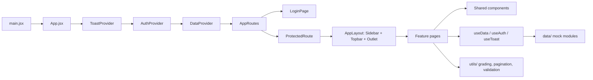
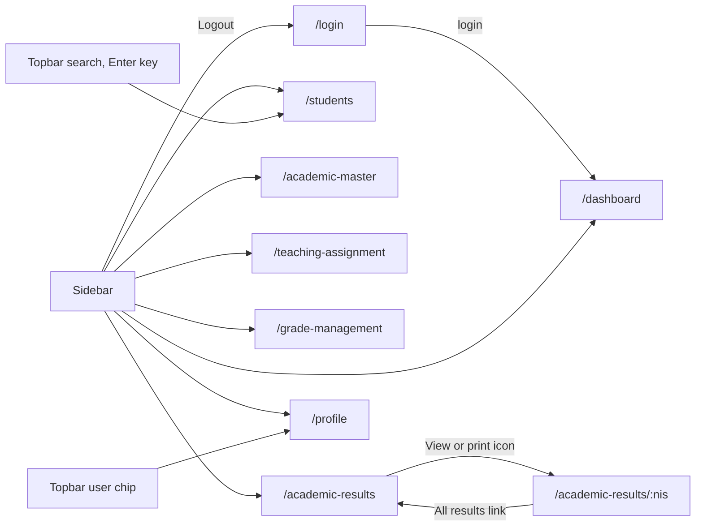
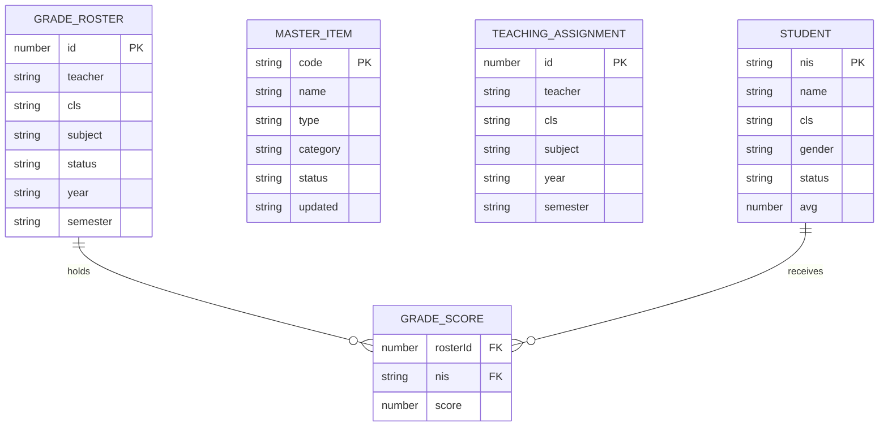
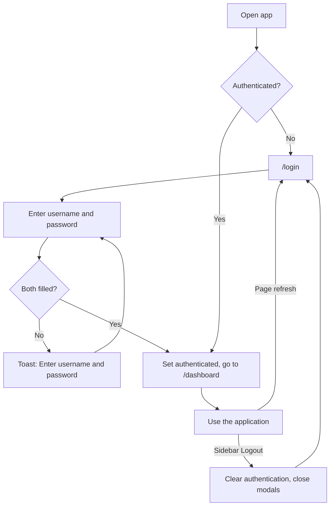
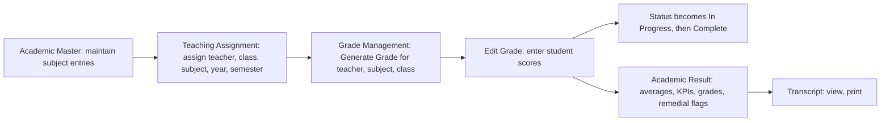
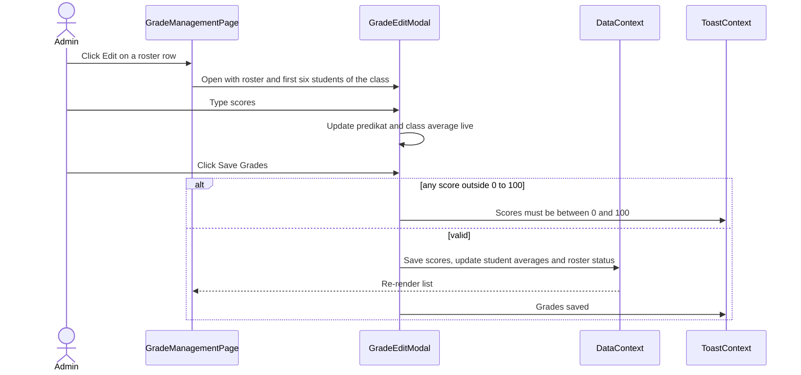

# My Academic — Frontend Master Design & Technical Specification

|  |  |
| --- | --- |
| **Document type** | Frontend technical blueprint |
| **Product** | My Academic (school academic information system) |
| **Application type** | Single Page Application (SPA) |
| **Implementation stack** | React.js + Vite + Bootstrap + JavaScript + CSS |
| **Version / date** | 1.0 — October 2, 2026 |
| **Status** | Prototype completed; this document guides its implementation |

## About this document

The completed My Academic prototype is the **source of truth for UI/UX and functional behavior**: pages, navigation, components, flows, forms, tables, modals, interactions, features and roles. The stack above is the **source of truth for how it is built**: architecture, project structure, routing, state, styling and future development.

How to read it:

- **"Prototype behavior"** describes what the prototype does and must be reproduced.
- **"Blueprint"** describes how to build it with React + Vite + Bootstrap.
- **Section 13.1** lists places where the prototype is inconsistent or simplified, with a recommendation for each.
- No code is included. No API endpoints are defined.

**Glossary (terms used in the UI):** *NIS* student ID number · *NIP* teacher/staff employee number · *NISN* national student number (transcript only) · *Ganjil* odd semester · *Genap* even semester · *Tuntas* passed/completed · *Remedial* below passing, needs follow-up · *Lulus* passed.

---

## 1. Project Overview

### 1.1 Purpose

My Academic is a web application for managing a school's academic data and processes: students, core academic master data, teaching assignments, grade entry, and academic results.

### 1.2 Application type

A browser-based **Single Page Application**. One HTML page is loaded once; React switches screens client-side without full page reloads.

### 1.3 Scope of the prototype

In scope: login, dashboard, student management, academic master data, teaching assignments, grade management, academic results (directory and per-student transcript), and user profile — all running on **local mock data** with working navigation, forms, validation, filters, pagination, modals and notifications.

Out of scope: real authentication, persistence, real data computation, file generation, and any server communication (see Sections 12–13).

### 1.4 Target users

The prototype represents **one role: Administrator** (mock user "Sarah Jenkins", SMA Negeri 1 Harapan Bangsa). See Section 9.

### 1.5 Main modules

| # | Module | Purpose |
| --- | --- | --- |
| 1 | Login | Enter the application |
| 2 | Dashboard | Academic overview and recent activity |
| 3 | Students | List, search, add, edit, delete student records |
| 4 | Academic Master | Maintain core master entries (code, name, status) |
| 5 | Teaching Assignment | Assign teachers to subjects and classes per academic year and semester |
| 6 | Grade Management | Generate grade rosters per teacher/subject/class and enter student scores |
| 7 | Academic Result | Directory of student results with KPIs, and a printable per-student transcript |
| 8 | Profile | Personal information and password change |

### 1.6 Language note

The interface is primarily English with a few Indonesian terms retained from the prototype: search placeholder "Cari data...", dashboard subtitle "Overview akademik sekolah", login subtitle "Sistem Informasi Akademik", semester names Ganjil/Genap, status words Tuntas/Remedial/Lulus. Keep them exactly as is.

---

## 2. Technology Stack

| Concern | Choice | Notes |
| --- | --- | --- |
| UI library | **React.js** | Function components and hooks only |
| Build tool / dev server | **Vite** | Standard React template; `.jsx` source files |
| UI framework | **Bootstrap 5** | Imported as CSS; **Bootstrap's JavaScript bundle is not used** — React state controls modals, toasts and the sidebar |
| Language | **JavaScript** | No TypeScript |
| Styling | **CSS** | One theme file overriding Bootstrap variables, plus small custom classes |
| Routing | **React Router** (`react-router-dom`) | Client-side routing for the SPA |
| State | **React built-ins** | `useState` / `useReducer` plus three small Context providers |
| Icons | **Material Symbols Outlined** | Loaded as a font, as in the prototype |
| Fonts | **Inter** (UI) and **JetBrains Mono** (codes and IDs) | Google Fonts links in `index.html` |

Dependencies are intentionally limited to `react`, `react-dom`, `react-router-dom` and `bootstrap`. Do **not** add a state library, a component kit, a table library, a form library or a date library; the prototype needs none of them.

---

## 3. Simple Frontend Architecture

### 3.1 Structure at a glance



### 3.2 Responsibilities

| Part | Responsibility |
| --- | --- |
| `main.jsx` / `App.jsx` | Mount React, import Bootstrap CSS and the theme file, wrap providers, render routes |
| Routes | Map URLs to pages; `ProtectedRoute` redirects unauthenticated visitors to `/login` |
| Layout | `AppLayout` renders the fixed Sidebar, fixed Topbar and the page area (`Outlet`) |
| Pages | One component per screen; own that screen's UI state (search text, filters, current page, which modal is open) |
| Components | Reusable presentation pieces shared by several pages |
| Context | Shared state: who is logged in, the mock data and its CRUD actions, and the toast |
| Data | Plain JavaScript modules exporting the seed mock data and reference lists |
| Utils | Pure helper functions (grade rules, pagination slicing, validation checks) |

### 3.3 How the parts interact

1. A page reads data and calls actions from `useData()` (for example add a student).
2. The action updates state held in `DataProvider`; every page reading that data re-renders.
3. The page shows feedback with `useToast()`.
4. Filters, search text, current page and open modals are **local to the page**, not global. (The one exception is the Topbar search; see Section 6.4.)

### 3.4 State management approach

| State | Where it lives | Resets on refresh |
| --- | --- | --- |
| Authenticated flag and current user (including profile fields) | `AuthContext` | Yes — user returns to login |
| Students, master items, teaching assignments, grade rosters, grade scores | `DataContext` | Yes — reseeded from mock data |
| Toast message | `ToastContext` | n/a |
| Sidebar collapsed/expanded | `AppLayout` local state | Yes |
| Search, filters, pagination, modal open/closed, form fields | Page or modal local state | Yes |

Reproducing the prototype's reset-on-refresh behavior is intended. There is no browser storage.

---

## 4. Project Structure

Practical structure for the Vite React project:

```text
my-academic/
├─ index.html                  Google Fonts + Material Symbols links
├─ package.json
├─ vite.config.js
├─ public/
│  └─ logo.svg                 My Academic logo mark
└─ src/
   ├─ main.jsx
   ├─ App.jsx
   ├─ routes/
   │  ├─ AppRoutes.jsx
   │  └─ ProtectedRoute.jsx
   ├─ layouts/
   │  └─ AppLayout.jsx         Sidebar + Topbar + page outlet
   ├─ pages/
   │  ├─ LoginPage.jsx
   │  ├─ DashboardPage.jsx
   │  ├─ StudentsPage.jsx
   │  ├─ AcademicMasterPage.jsx
   │  ├─ TeachingAssignmentPage.jsx
   │  ├─ GradeManagementPage.jsx
   │  ├─ AcademicResultListPage.jsx
   │  ├─ AcademicResultDetailPage.jsx
   │  └─ ProfilePage.jsx
   ├─ components/
   │  ├─ layout/               Sidebar, Topbar, PageHeader, Breadcrumb
   │  ├─ ui/                   Icon, Avatar, StatusBadge, Modal, ConfirmDialog,
   │  │                        ToastHost, Pagination, FilterBar, FormField,
   │  │                        PasswordField, FormNote, StatCard, EmptyRow
   │  ├─ students/             StudentFormModal
   │  ├─ master/               MasterFormModal
   │  ├─ teaching/             AssignmentFormModal
   │  ├─ grades/               GenerateGradeModal, GradeEditModal
   │  └─ results/              ResultKpiCards, TranscriptHeader
   ├─ context/
   │  ├─ AuthContext.jsx
   │  ├─ DataContext.jsx
   │  └─ ToastContext.jsx
   ├─ data/
   │  ├─ referenceData.js      classes, subjects, years, semesters, teachers, subject icons
   │  ├─ students.js
   │  ├─ masterItems.js
   │  ├─ teachingAssignments.js
   │  └─ gradeRosters.js
   ├─ utils/
   │  ├─ grading.js            predikat and letter-grade rules
   │  ├─ pagination.js         page slicing and page-number list
   │  ├─ validation.js         email and password rule checks
   │  └─ transcript.js         builds the mock transcript for one student
   └─ styles/
      └─ theme.css             Bootstrap overrides, design tokens, custom classes, print rules
```

Conventions: one component per file, PascalCase file names for components, camelCase for utilities and data, page-specific modals live next to their feature folder, and anything used by two or more pages lives in `components/ui` or `components/layout`.

---

## 5. Pages & Routing

### 5.1 Route table

| Route | Page component | Access | Notes |
| --- | --- | --- | --- |
| `/login` | `LoginPage` | Public | Standalone, no sidebar or topbar |
| `/` | — | — | Redirects to `/dashboard` |
| `/dashboard` | `DashboardPage` | Administrator |  |
| `/students` | `StudentsPage` | Administrator | Accepts an optional `q` search parameter set by the Topbar search |
| `/academic-master` | `AcademicMasterPage` | Administrator |  |
| `/teaching-assignment` | `TeachingAssignmentPage` | Administrator |  |
| `/grade-management` | `GradeManagementPage` | Administrator |  |
| `/academic-results` | `AcademicResultListPage` | Administrator |  |
| `/academic-results/:nis` | `AcademicResultDetailPage` | Administrator | Transcript for one student. Unknown NIS falls back to the first student, as in the prototype |
| `/profile` | `ProfilePage` | Administrator |  |
| `*` | — | — | Redirect to `/dashboard` when logged in, otherwise `/login` |

All Add / Edit / Delete / Generate screens in the prototype are **modals opened by page state, not routes**. Do not create routes for them.

Logging out is not a route; it clears authentication and navigates to `/login`.

### 5.2 Route map



### 5.3 Page specifications

#### Login — `/login`

- **Purpose:** Enter the application.
- **Layout:** Centered card (max width 420px) on a soft background with two blurred decorative color circles (top-left pink, bottom-right blue). Logo, "MyAcademic" wordmark, subtitle "Sistem Informasi Akademik".
- **Fields:** Username / Email (prefilled `admin@sman1harapan.sch.id`), Password (prefilled `demo1234`) with show/hide eye icon. Full-width uppercase LOGIN button.
- **Interactions:** Submitting with either field empty shows the toast "Enter username and password". **Any non-empty credentials are accepted** and navigate to `/dashboard`. The eye icon toggles password visibility.

#### Dashboard — `/dashboard`

- **Purpose:** Academic overview.
- **Components:** `PageHeader` (title "Dashboard", subtitle "Overview akademik sekolah"); four `StatCard`s — Students **1,245** (icon `group`), Teachers **86** (`person_apron`), Classes **42** (`meeting_room`), Academic Year **2026/2027** (`calendar_today`); two info cards — "Academic Overview: Current Semester Ganjil" and "Active Academic Period: 2026/2027 Ganjil"; a "Recent Activity" list of three rows.
- **Recent Activity rows:** "Grade submitted — Mathematics — XI IPA 1" (icon `assignment_turned_in`); "New student registered — {first name of the most recently added student}" (icon `person_add`); "Teaching assignment updated" (icon `edit_calendar`). Rows alternate a faint background and highlight on hover.
- **Interactions:** none. The figures are static and do not change when data is edited.

#### Students — `/students`

- **Purpose:** Manage student records.
- **Header:** "Students" / "Manage student information", primary button **Add Student** (icon `add`).
- **Toolbar (card):** search "Search student...", Class dropdown, Status dropdown.
- **Table columns:** NIS (monospace), Student Name (medium weight), Class, Gender, Status (badge), Action (edit icon, delete icon).
- **Footer:** "Showing X to Y of N" with pagination, 6 rows per page.
- **Modals:** Add Student, Edit Student, delete confirmation (Section 10.3).
- **Empty state:** a centered row reading "No students found".

#### Academic Master — `/academic-master`

- **Purpose:** Maintain core master entries.
- **Header:** "Academic Master" / "Manage core academic master data", primary button **Add New**.
- **Table columns:** Code (monospace, primary color, bold), Name (bold), Status badge, Updated, Action (**Edit** text link with pencil icon). There is **no delete** and no search/filter. 6 rows per page, newest added entry appears first.
- **Modals:** Add Academic Master, Edit Subject Master.

#### Teaching Assignment — `/teaching-assignment`

- **Breadcrumb:** "ACADEMIC ROSTER / Allocations".
- **Header:** "Teaching Assignment" / "Assign teachers to classes and subjects", primary button **Create Assignment**.
- **Filter card:** Academic Year, Semester, Class, Teacher.
- **List card:** title "Active Assignments" with a pink badge "N entries", right-aligned label "TA {year} • {Ganjil|Genap|All Semesters first word}". Table columns: Teacher (avatar, name, "NIP: …"), Class (blue badge), Subject (icon + name), Semester (pink badge), Action (Edit link, delete icon). Footer "Showing 1 to N of N records" — **no pagination controls**.
- **Modals:** Create Teaching Assignment, Edit Teaching Assignment, delete confirmation.

#### Grade Management — `/grade-management`

- **Breadcrumb:** "ACADEMIC › GRADE MANAGEMENT".
- **Header:** "Grade Management" / "Select teaching class and subject to view or manage student grades". Three summary chips (Complete / In Progress / Not Started with counts; hidden below the lg breakpoint) and primary button **Generate Grade**.
- **Filter card:** search "Search class or subject...", Year, Semester, Class, Subject.
- **Table columns:** Class (colored "XI" tile, class name, "MIPA • Room 204/205" or "IPS • Room 301"), Subject (icon + name), Teacher (avatar + name), Students (chip such as "32 Students"), Grading Status (badge), Action (**Edit** and **Delete** small buttons). 6 rows per page.
- **Modals:** Generate Grade, Edit Grade (score entry), delete confirmation.

#### Academic Result (directory) — `/academic-results`

- **Breadcrumb:** "ACADEMIC › ACADEMIC RESULT".
- **Header:** "Academic Result" / "Directory and cumulative grade ledger for all registered students across classes". Buttons: **Download Summary** (white, mock toast) and **Export Transcripts** (primary, opens the browser print dialog).
- **KPI cards (4):** Total Students Assessed ("N / N Enrolled"), Ledger Mean Score, Passing Rate (percentage with "N Pass"), Remedial Flagged (count, "Requires Follow-up", red styling).
- **Filter card:** search "Search student by name or NIS...", Year, Semester, Class, Status.
- **Table columns:** NIS, Student Name (avatar + name + generated email), Class, Total Subjects ("7 Subjects" chip), Average Score (right-aligned), Overall Grade (badge), Status (badge), Actions (**View** link, print icon). 6 rows per page.

#### Academic Result (transcript) — `/academic-results/:nis`

- **Heading line:** "SEMESTER EVALUATION • Formal Transcript" plus a "← All results" link back to the directory.
- **Header:** "Academic Result" / "View your academic performance"; buttons **Print Sheet** (browser print) and **Download PDF** (mock toast).
- **Student card (3 columns):** Student (name, "NISN: …"), Class (name, track text — "Science & Mathematics Track" for IPA classes, "Social Sciences Track" for IPS), Academic Period ("2026/2027 — Ganjil", "Active Semester").
- **Ledger card:** title "Cumulative Grade Ledger" with a "5 Registered Subjects" chip. Columns Subject (icon tile + name), Assignment, Mid, Final, Score (bold), Grade (badge), right-aligned numbers. Five fixed subjects: Mathematics, Physics, English, Biology, Chemistry. Footer: "All grade components validated by academic registrar" and an **Average Score** pill.
- **Print:** sidebar, topbar and elements marked "no-print" are hidden when printing.

#### Profile — `/profile`

- **Breadcrumb:** "ACCOUNT › USER PROFILE".
- **Header:** "Profile" / "Manage your personal information, school credentials, and account security." Buttons **Discard** (soft) and **Save Changes** (primary).
- **Left card (300px column):** initials avatar "SJ" with camera button, name, "SMA Negeri 1 Harapan Bangsa", badges Administrator and Active, an info panel (NIP / ID `19780512 200312 2 004`, Email, Phone, Last Login "Today, 08:30 WIB"), **Change Photo** button.
- **Personal Information card:** Full Name & Title, NIP / Employee Number (read-only), Official Institutional Email, Contact Phone / WhatsApp, Gender (Female / Perempuan, Male / Laki-laki), Department & Assignment ("Academic Administrator & Staff", read-only).
- **Security & Password card:** Current Password, New Password, Confirm New Password (each with eye toggle); a "Requirements" row of three static chips (8+ characters; Contains letters & numbers; Special symbol (!@#$)); **Cancel** and **Update Password** buttons.

---

## 6. Navigation

### 6.1 Sidebar

Fixed to the left, full height, white translucent with blur. **Width 256px expanded, 80px collapsed.**

| Order | Item | Icon (Material Symbols) | Route |
| --- | --- | --- | --- |
| 1 | Dashboard | `dashboard` | `/dashboard` |
| — | *Section label: ACADEMIC* |  |  |
| 2 | Students | `school` | `/students` |
| 3 | Academic Master | `database` | `/academic-master` |
| 4 | Teaching Assignment | `co_present` | `/teaching-assignment` |
| 5 | Grade Management | `assignment_turned_in` | `/grade-management` |
| 6 | Academic Result | `analytics` | `/academic-results` and `/academic-results/:nis` |
| — | *Section label: ACCOUNT* |  |  |
| 7 | Profile | `account_circle` | `/profile` |
| 8 | Logout | `logout` | Clears authentication, goes to `/login` |

- **Header area:** logo mark + "MyAcademic" wordmark, and a toggle button (icon `menu_open`).
- **Active item:** solid pink background (`#e2165f`), white semibold text, soft pink shadow. The Academic Result item stays active on the transcript page.
- **Hover:** light blue background (`#dee8ff`).
- **Collapsed state:** wordmark, labels and section labels are hidden; icons are centered; each item keeps a tooltip (title) with its name.
- **Logout** acts immediately, with no confirmation.

### 6.2 Sidebar toggle

A button in the sidebar header switches between 256px and 80px. The Topbar's left edge and the page's left padding follow the sidebar width. The state is local to `AppLayout` and is not remembered after refresh.

### 6.3 Topbar

Fixed, 64px high, white translucent with blur, starting at the sidebar's right edge.

| Element | Behavior |
| --- | --- |
| Search field (placeholder "Cari data...") | Pressing **Enter** opens `/students` with the typed text applied as the student search and the list reset to page 1 |
| Notification bell | A permanent pink dot; click shows the toast "3 new notifications" |
| User chip | Initials avatar, name "Sarah Jenkins", role "Administrator" (name block hidden under the sm breakpoint). Click opens `/profile` |

### 6.4 Topbar search implementation

Pass the text to the Students page as a `q` URL search parameter; the Students page initializes its search box from it.

### 6.5 Breadcrumbs

Small uppercase text (11px, semibold, 0.04em letter spacing) above the page title. The last segment is primary color. They are **not clickable**, except the transcript's "← All results" link.

| Page | Breadcrumb text |
| --- | --- |
| Teaching Assignment | ACADEMIC ROSTER / Allocations |
| Grade Management | ACADEMIC › GRADE MANAGEMENT |
| Academic Result | ACADEMIC › ACADEMIC RESULT |
| Transcript | SEMESTER EVALUATION • Formal Transcript · ← All results |
| Profile | ACCOUNT › USER PROFILE |
| Dashboard, Students, Academic Master | none |

### 6.6 Tabs

The prototype has **no tab components**. Do not add any.

### 6.7 Page-to-page navigation

Only the Sidebar, the Topbar search/user chip, the Academic Result **View/print** actions, and the transcript back link move between pages. Browser back/forward should work through React Router.

### 6.8 Role-based navigation

The prototype shows one fixed navigation for its single role. Define the sidebar items in one array (label, icon, route, section) so a role filter can be added later without restructuring. No role filtering is implemented now.

### 6.9 Logout

Clears the authenticated flag, closes any open modal, and navigates to `/login`. Data state is not preserved (it resets with the app).

---

## 7. UI/UX & Design System

All values below come from the prototype. Put them in `styles/theme.css` as CSS variables, and map Bootstrap's own variables to them.

### 7.1 Layout

| Element | Value |
| --- | --- |
| Sidebar | Fixed, 256px (collapsed 80px), full height |
| Topbar | Fixed, 64px high |
| Page area | Top padding 96px (clears the topbar), horizontal padding 24px, bottom 40px, content centered with **max width 1440px** |
| Page header | Title left, action buttons right; wraps on narrow screens; 20px below |
| Section gaps | 24px between cards in grids; 20px between filter card and table |
| Background | `#f9f9ff` |

### 7.2 Colors

| Token | Hex | Used for |
| --- | --- | --- |
| Primary | `#b80049` | Primary buttons, link-style actions, accent text, active page numbers |
| Primary container | `#e2165f` | Active sidebar item, button hover |
| Background | `#f9f9ff` | Page background, modal footer |
| Surface low | `#f0f3ff` | Input background, table header, pager bar |
| Surface | `#e7eeff` | Icon tiles, info notes, read-only fields |
| Surface high | `#dee8ff` | Secondary button, sidebar hover |
| On surface | `#111c2d` | Main text |
| On surface variant | `#5b3f43` | Secondary text, labels |
| Tertiary | `#4353b5` | Info badges and info-note text |
| Scrim | `#263143` at 45% | Modal backdrop; also toast background (solid) |
| Input focus | `#e91e63` | Focus border (with a 3px ring at 12% opacity) |

**Status color pairs** (background / text):

| Variant | Colors | Used for |
| --- | --- | --- |
| Green | `#d1fae5` / `#047857` | Complete, "Tuntas" |
| Amber | `#fef3c7` / `#b45309` | In Progress, "Remedial" in score predikat |
| Blue | `#dee8ff` / `#4353b5` | Active, class names, subject-count and info badges |
| Pink | `#fce7f3` / `#b80049` | Semester badges, entry-count badge, Administrator badge, "Remedial Needed", low grades |
| Gray | `#e2e8f0` / `#475569` | Not Started, Inactive |
| Red (KPI only) | `#fef2f2` icon tile, `#b91c1c` text | Remedial Flagged card, failing average numbers |
| Teal | `#f0fdfa` / `#0f766e` | Password requirement chips |

Avatar colors cycle by row position through three pairs: pink (`#fce7f3` / primary), blue (`#dee8ff` / tertiary), orange (`#ffedd5` / `#c2410c`).

### 7.3 Typography

| Use | Spec |
| --- | --- |
| Font | Inter, weights 400/500/600/700 |
| Page title | 30px, semibold, slightly negative letter spacing |
| Page subtitle | 14px, secondary text color |
| KPI / stat figures | 36px, semibold |
| Modal title | 24px, semibold |
| Body and table text | 14px |
| Table header | 11px, 600, uppercase, 0.04em letter spacing, secondary text color |
| Form labels | 11px, 600, uppercase, 0.04em letter spacing |
| Badges | 11px, 600 |
| Codes and IDs (NIS, master code, transcript NIS) | JetBrains Mono, 12px |
| All numbers in tables, KPIs, scores | **tabular figures** so digits align |

### 7.4 Spacing and shape

| Item | Value |
| --- | --- |
| Spacing rhythm | 4px / 8px / 16px / 24px steps |
| Card radius | 12px |
| Modal radius | 16px |
| Button, input, select radius | 8px |
| Badge radius | Pill (fully rounded) |
| Avatar | Circle, 32px (list rows) |
| Card shadow | `0 1px 4px rgba(17,28,45,0.05)` |
| Table cell padding | 12px vertical, 16px horizontal |

### 7.5 Buttons

| Variant | Style | Used for |
| --- | --- | --- |
| Primary | 40px high, 16px side padding, 14px semibold, background `#b80049`, white text, soft pink shadow; hover `#e2165f` | Add, Create, Save, Update, Generate, Login |
| Soft (secondary) | Background `#dee8ff`, primary-colored text, no shadow | Discard, Cancel in profile, row Edit/Delete in Grade Management |
| White | White background, dark text | Download Summary, Print Sheet |
| Small | 32px high, 12px side padding | Grade Management row actions |
| Text link action | Primary color, 14px semibold, with a leading icon | Edit (Master, Teaching), View (Results) |
| Icon button | Icon only, light blue hover | Edit/delete in Students, delete in Teaching, print in Results, modal close |
| Modal cancel | Text-only button with light hover | Every modal footer |

Primary buttons carry a leading Material icon where the prototype has one (`add`, `check`, `download`, `print`, `upload`, `photo_camera`).

### 7.6 Forms

- **Inputs and selects:** 40px high, 12px side padding, background `#f0f3ff`, transparent border, 8px radius, 14px text. **Focus:** border `#e91e63` and a 3px translucent ring. Selects are native `select` elements styled like inputs.
- **Labels:** above the field, uppercase style from 7.3.
- **Two-column rows:** used for Class + Gender, Subject Code + Status, Academic Year + Semester, and in Profile fields.
- **Read-only fields:** background `#e7eeff`, monospace for IDs; the student NIS shows an inline badge "Read-only / Unique" when editing.
- **Password fields:** eye button inside the field's right edge toggles visibility.
- **Info note:** rounded blue-tinted box with an `info` icon and 12px text, placed below the fields in some modals.
- **Validation display:** no inline error messages in the prototype. Errors appear as **toasts** (Section 10.4).

### 7.7 Tables

Inside a white card with hidden overflow. Header row on `#f0f3ff`. Rows separated by a faint top border; row hover tints to `#fdf5f8`. Numeric columns are right-aligned (Average Score, ledger scores). Action columns are right-aligned. Table footer bar (`#f0f3ff`) holds "Showing X to Y of N" on the left and pagination on the right.

**Pagination control:** 32px square buttons with 8px radius, previous/next chevrons, active page in primary background with white text. For six or more pages it shows the first three pages, the current page, and the last page, separated by an ellipsis where numbers are skipped; for fewer than six it shows all pages. Previous/next clamp at the ends.

### 7.8 Cards

White, 12px radius, light shadow. Variants in use: **stat card** (label + icon tile on top, large number below), **info card** (small uppercase label + value), **filter card** (row of controls), **list/table card**, **profile card**, **form card**, **KPI card** (icon tile + label + figure).

### 7.9 Modals

| Property | Value |
| --- | --- |
| Backdrop | `#263143` at 45% with a 4px blur, centered panel, 16px page padding |
| Panel | White, 16px radius, large shadow, scrolls internally when taller than 92% of the viewport |
| Width | Standard 448px; Edit Grade 672px; delete confirmation 384px |
| Header | Title (24px) + subtitle (14px) on the left, close (X) button on the right |
| Body | 24px side padding |
| Footer | Background `#f9f9ff`, right-aligned **Cancel** (text) and primary action (with `check` icon) |
| Closing | X button, Cancel, or clicking the backdrop. The prototype does **not** close on the Escape key (see 13.1) |

### 7.10 Status indicators

| Where | Display |
| --- | --- |
| Student / Master status | Blue badge "Active"; gray badge for Inactive |
| Grading status | Badge with a leading dot: green Complete, amber In Progress, gray Not Started |
| Score predikat | Badge with dot: green "A - Tuntas" / "B - Tuntas", amber "C - Remedial" |
| Results status | Blue "Lulus / Pass", pink "Remedial Needed" |
| Overall grade | Letter in a badge: blue normally, pink when the average is under 75 |
| Average number | Pink-red when under 75, primary color at 90 and above |
| Notification | Pink dot on the bell |

### 7.11 Responsive behavior

| Breakpoint (prototype) | Behavior |
| --- | --- |
| 900px and below | Sidebar is forced to the 80px icon rail; topbar and page offsets follow |
| Under 640px | User name/role text in the topbar is hidden |
| 640px and up | Dashboard stat cards and Results KPI cards use 2 columns |
| 1024px and up | Dashboard stat cards and Results KPI cards use 4 columns; Profile uses a 300px + flexible two-column layout (stacked below); Grade Management summary chips appear |
| Header buttons / filter bars | Wrap onto new lines when space runs out |
| Print | Sidebar, topbar and "no-print" elements are hidden; page padding removed |

When implementing with Bootstrap, use its `md` (768) and `lg` (992) breakpoints for the column changes; the \~32px difference from the prototype's 1024px is acceptable. Keep the **900px** rule as a custom media query for the sidebar rail.

### 7.12 Bootstrap usage

Use Bootstrap 5 **CSS only**. Theme it once in `theme.css` by overriding Bootstrap's CSS variables (primary color, body background, font family, border radius) and by adding a few small custom classes. Do not scatter inline colors.

| Prototype pattern | Bootstrap approach |
| --- | --- |
| Page content grids (stat cards, KPI cards, two-column forms, profile layout) | Grid: `row` / `col-*` with gutters, or `d-grid` utilities |
| Spacing, flex alignment, text utilities | Bootstrap utilities (`d-flex`, `gap-*`, `p-*`, `text-*`, `fw-*`) |
| Primary button | `btn btn-primary` with the theme overriding its colors, radius and height |
| Soft / white button, small button | `btn` plus custom modifier classes (e.g. soft, white) and `btn-sm` |
| Inputs and selects | `form-control`, `form-select`, `form-label` restyled in theme |
| Cards | `card` restyled (radius, shadow, no border) |
| Tables | `table table-hover align-middle` inside a card, wrapped in `table-responsive` |
| Badges and chips | `badge rounded-pill` with custom color modifiers for the variants in 7.2 |
| Pagination | `pagination` markup restyled to the square-button look |
| Modals | Bootstrap modal **class names and markup** rendered conditionally by a React `Modal` component (no Bootstrap JS), with the custom backdrop |
| Toast | Custom `ToastHost` positioned bottom-center (Bootstrap toast classes optional) |
| Sidebar and Topbar | **Custom layout CSS** (fixed positioning); do not use Bootstrap's navbar or offcanvas |
| Breadcrumb | Custom small-caps style (not Bootstrap's breadcrumb) |

---

## 8. Components

### 8.1 Layout components

| Component | Responsibility |
| --- | --- |
| `AppLayout` | Holds sidebar collapsed state; renders `Sidebar`, `Topbar` and the routed page; applies left offsets |
| `Sidebar` | Renders the nav config array, active highlighting (including the transcript child route), collapse behavior, logo, Logout |
| `Topbar` | Search field (Enter navigates to Students), notification bell (toast), user chip (to Profile) |
| `PageHeader` | Title, subtitle, and a right-side slot for action buttons; optional `Breadcrumb` above |
| `Breadcrumb` | Renders the small uppercase trail text |

### 8.2 Shared UI components

| Component | Responsibility |
| --- | --- |
| `Icon` | Renders a Material Symbols icon by name |
| `Avatar` | Circular initials badge with the three-color cycle |
| `StatusBadge` | Pill badge with variant (green, amber, blue, pink, gray, teal) and optional leading dot |
| `StatCard` | Label + icon tile + large figure (Dashboard); also used as the base for KPI cards |
| `FilterBar` | Card containing an optional search input and a set of select filters; reports changes upward |
| `FormField` | Label + control wrapper for inputs and selects |
| `PasswordField` | Password input with show/hide toggle |
| `FormNote` | Blue info note with icon |
| `Modal` | Backdrop + panel with title, subtitle, body slot, footer with Cancel and primary action; backdrop-click and close button; width option (standard / wide / small) |
| `ConfirmDialog` | Small `Modal` for delete confirmation |
| `Pagination` | Footer bar with "Showing X to Y of N" and the page buttons (Section 7.7) |
| `ToastHost` | Displays the current toast bottom-center; auto-dismiss after **2.4 seconds** |
| `EmptyRow` | Table row with centered muted text when no rows match |

### 8.3 Feature components

| Component | Used by | Responsibility |
| --- | --- | --- |
| `StudentFormModal` | Students | Add and Edit form; add shows the next NIS read-only, edit shows the existing NIS with the "Read-only / Unique" badge and an info note |
| `MasterFormModal` | Academic Master | Add (Master Type selectable) and Edit (type shown read-only) |
| `AssignmentFormModal` | Teaching Assignment | Create and Edit teacher/class/subject/year/semester |
| `GenerateGradeModal` | Grade Management | Teacher, Subject, Class selects with an info note |
| `GradeEditModal` | Grade Management | Score table with live predikat and class average (Section 10.6) |
| `ResultKpiCards` | Academic Result list | The four KPI cards computed from student data |
| `TranscriptHeader` | Transcript | Three-column student / class / period card |

### 8.4 Pages

Pages (Section 4) compose the components above, own their local state (search text, filters, page number, which modal is open and for which record) and call `DataContext` actions.

### 8.5 Context providers

| Provider | Exposes |
| --- | --- |
| `AuthContext` | `isAuthenticated`, `currentUser` (name, role, email, phone, gender, fixed NIP, department), `login()`, `logout()`, `updateProfile()` |
| `DataContext` | The five datasets and their actions: add/update/delete student; add/update master item; add/update/delete assignment; generate/delete roster; save grade scores |
| `ToastContext` | `showToast(message)` |

### 8.6 Utilities

| Module | Contents |
| --- | --- |
| `grading.js` | Predikat rule (Section 10.6) and letter-grade rule (Section 10.7) |
| `pagination.js` | Slice for the current page; list of page numbers to display |
| `validation.js` | Email check (non-space characters, `@`, non-space characters), password rule check |
| `transcript.js` | Builds the mock five-subject transcript for a student (Section 10.7) |

---

## 9. Roles & Access

### 9.1 Implemented role

**Administrator** is the only role shown in the prototype. The signed-in mock user is Sarah Jenkins, M.Pd, "Administrator", "SMA Negeri 1 Harapan Bangsa", status Active.

### 9.2 Access matrix (Administrator)

| Module | View | Search / filter | Add | Edit | Delete | Other |
| --- | --- | --- | --- | --- | --- | --- |
| Dashboard | Yes | — | — | — | — | — |
| Students | Yes | Search, Class, Status | Yes | Yes (NIS locked) | Yes (confirm) | — |
| Academic Master | Yes | None | Yes | Yes | **No** | — |
| Teaching Assignment | Yes | Year, Semester, Class, Teacher | Yes | Yes | Yes (confirm) | — |
| Grade Management | Yes | Search, Year, Semester, Class, Subject | Generate roster | Edit scores | Delete roster (confirm) | — |
| Academic Result | Yes | Search, Year, Semester, Class, Status | — | — | — | View transcript, print, mock downloads |
| Profile | Own profile | — | — | Own details and password | — | Mock photo change |

### 9.3 Blueprint

- Store the user's `role` value ("Administrator") on `currentUser`.
- `ProtectedRoute` checks **authentication only**.
- There is no per-module or per-action permission checking in the prototype; build none now.
- Roles for teachers and students are **not represented** in the prototype's screens. They are future work (Section 13.3).

---

## 10. Data & Interaction

### 10.1 Data model



Relationships to teachers, classes and subjects are made **by name (text)**, not by id. Teachers, classes and subjects come from fixed reference lists (10.2), not from the Academic Master data.

#### Entity fields

| Entity | Field | Meaning / allowed values |
| --- | --- | --- |
| **Student** | `nis` | Unique ID string, e.g. `10001`; read-only after creation |
|  | `name` | Full name |
|  | `cls` | `XI IPA 1`, `XI IPA 2`, `XI IPS 1` |
|  | `gender` | `Male`, `Female` |
|  | `status` | `Active`, `Inactive` |
|  | `avg` | Average score (number, 1 decimal) used by Academic Result |
| **Master item** | `code` | Unique, stored uppercase |
|  | `name` | Display name |
|  | `type` | `Subject`, `Teacher`, `Class`, `Academic Year` (chosen on Add) |
|  | `category` | `Science / MIPA`, `Social / IPS`, `Language & Culture`, `General Compulsory` |
|  | `status` | `Active`, `Inactive` |
|  | `updated` | Text, e.g. "Today" |
| **Teaching assignment** | `id` | Unique number |
|  | `teacher`, `cls`, `subject` | Names from reference lists |
|  | `year`, `semester` | From reference lists |
| **Grade roster** | `id` | Unique number |
|  | `teacher`, `cls`, `subject`, `year`, `semester` | As above |
|  | `status` | `Complete`, `In Progress`, `Not Started` |
| **Grade scores** | keyed by roster id, then student NIS | Number from 0 to 100, or empty |
| **Current user / profile** | `name`, `email`, `phone`, `gender` (editable); `nip`, `department`, `role`, `school` (fixed) |  |

### 10.2 Reference data (fixed lists, in `referenceData.js`)

| List | Values |
| --- | --- |
| Classes | XI IPA 1, XI IPA 2, XI IPS 1 |
| Subjects | Mathematics, Physics, English, Biology, Chemistry, Sociology |
| Academic years | 2026/2027, 2025/2026, 2024/2025 |
| Semesters | Ganjil (Odd), Genap (Even); the Teaching Assignment filter also offers "All Semesters" |
| Subject icons | Mathematics `calculate`, Physics `bolt`, English `translate`, Biology `biotech`, Chemistry `science`, Sociology `groups` |
| Master category options | Science / MIPA, Social / IPS, Language & Culture, General Compulsory |
| Master type options | Subject, Teacher, Class, Academic Year |

**Teachers (name — NIP):**

| Teacher | NIP |
| --- | --- |
| Budi Santoso, S.Pd | 19840312 200801 1 004 |
| Citra Dewi, M.Si | 19890724 201402 2 009 |
| Andi Pratama, M.Pd | 19910515 201803 1 002 |
| Sri Wahyuni, M.Pd | 19781109 200212 2 001 |
| Fauzi, S.Si | 19860408 201101 1 007 |
| Rahmat Hidayat, M.Kom | 19800101 200501 1 003 |

**Class display facts (hard-coded in Grade Management and the Grade edit modal):** XI IPA 1 → "MIPA • Room 204", 32 students; XI IPA 2 → "MIPA • Room 205", 30 students; XI IPS 1 → "IPS • Room 301", 28 students. The "XI" tile is pink for XI IPA 1 and blue for the others.

### 10.3 Mock data (seed)

**Students — 42 records, NIS `10001` to `10042`.** The first six are fixed:

| NIS | Name | Class | Gender | Avg |
| --- | --- | --- | --- | --- |
| 10001 | Andi Pratama | XI IPA 1 | Male | 85.2 |
| 10002 | Budi Santoso | XI IPA 1 | Male | 78.5 |
| 10003 | Citra Dewi | XI IPA 2 | Female | 91.0 |
| 10004 | Dian Anugrah | XI IPA 2 | Male | 86.4 |
| 10005 | Eko Prasetyo | XI IPS 1 | Male | 73.8 |
| 10006 | Fani Rahmawati | XI IPS 1 | Female | 88.0 |

Records 7–42 are generated filler: classes cycle through the three classes, genders alternate, status Active, averages between roughly 72 and 94. They may be hard-coded or generated with a simple loop; exact values are not significant. All students start **Active**.

**Master items — 8 records**, all status Active, updated "Today", type Subject, category Science / MIPA: `MAT` Mathematics · `PHY` Physics · `ENG` English · `BIO` Biology · `CHE` Chemistry · `HIST` History · `SOC` Sociology · `IND` Bahasa Indonesia.

**Teaching assignments — 5 records**, all year 2024/2025, semester Ganjil (Odd):

| Teacher | Class | Subject |
| --- | --- | --- |
| Budi Santoso, S.Pd | XI IPA 1 | Mathematics |
| Citra Dewi, M.Si | XI IPA 1 | Physics |
| Andi Pratama, M.Pd | XI IPA 2 | English |
| Sri Wahyuni, M.Pd | XI IPA 1 | Biology |
| Fauzi, S.Si | XI IPA 2 | Chemistry |

**Grade rosters — 6 records**, all year 2026/2027, semester Ganjil (Odd):

| Teacher | Class | Subject | Status |
| --- | --- | --- | --- |
| Budi Santoso, S.Pd | XI IPA 1 | Mathematics | Complete |
| Citra Dewi, M.Si | XI IPA 1 | Physics | In Progress |
| Andi Pratama, M.Pd | XI IPA 2 | English | Complete |
| Sri Wahyuni, M.Pd | XI IPA 1 | Biology | Not Started |
| Fauzi, S.Si | XI IPA 2 | Chemistry | In Progress |
| Rahmat Hidayat, M.Kom | XI IPS 1 | Sociology | Complete |

Grade scores start empty; they are created on first opening of a roster's Edit Grade modal (10.6).

**Initial UI defaults:** Teaching Assignment filter starts at year **2024/2025**, semester Ganjil (Odd). Grade Management and Academic Result start at **2026/2027**, Ganjil (Odd). Other filters start at "All".

### 10.4 Notifications (toasts)

A single toast at the bottom center of the screen: solid dark background (`#263143`), white 14px text, 8px radius, visible for **2.4 seconds**. A new toast replaces the current one. The complete message list:

| Area | Messages |
| --- | --- |
| Login | "Enter username and password" |
| Topbar | "3 new notifications" |
| Students | "Please complete all fields" · "Student added" · "Student updated" · "Student deleted" |
| Academic Master | "Code and name are required" · "Code already exists" · "Master data added" · "Master data updated" |
| Teaching Assignment | "Please select teacher, class and subject" · "Assignment created" · "Assignment updated" · "Assignment deleted" |
| Grade Management | "Please select teacher, subject and class" · "Roster already exists for that class and subject" · "Grade roster generated" · "Scores must be between 0 and 100" · "Grades saved" · "Roster deleted" |
| Academic Result | "Summary downloaded (mock)" · "PDF downloaded (mock)" |
| Profile | "Name and a valid email are required" · "Profile saved" · "Changes discarded" · "Photo upload is mocked" · "Enter your current password" · "Password does not meet requirements" · "Passwords do not match" · "Password updated" |

### 10.5 Search, filter, sort, pagination

| Page | Search | Filters (default) | Sort | Pagination |
| --- | --- | --- | --- | --- |
| Students | Name or NIS, case-insensitive partial match | Class (all), Status (all) | None — original order | 6 per page |
| Academic Master | None | None | None — newest added first | 6 per page |
| Teaching Assignment | None | Year (2024/2025), Semester (Ganjil), Class (all), Teacher (all) | None | None |
| Grade Management | Class, subject and teacher text, partial match | Year (2026/2027), Semester (Ganjil), Class (all), Subject (all) | None — newest generated first | 6 per page |
| Academic Result | Name or NIS | Year, Semester, Class (all), Status (all) | None | 6 per page |

Rules:

- **No column sorting exists anywhere.** Do not add it.
- Changing any search or filter resets that table to **page 1**.
- Filters combine with AND.
- Teaching Assignment's Semester filter "All Semesters" disables the semester condition.
- **Academic Result's Year and Semester dropdowns are displayed but do not filter** (see 13.1).
- Grade Management's three summary counts and Academic Result's KPI cards are calculated from **all** records, ignoring the current filters.

### 10.6 CRUD and form behavior

#### Students

- **Add:** NIS shown read-only (next number after the current record count). Required: Name (non-blank), Class (not the placeholder), Gender (not the placeholder). Status defaults to Active. A new student gets a random mock average between about 75 and 90. Saved at the end of the list; toast "Student added".
- **Edit:** NIS locked. Same required checks. Updates name, class, gender, status; toast "Student updated".
- **Delete:** opens `ConfirmDialog` — title "Delete?", message "Remove {name} permanently?", buttons Cancel / Delete; on confirm removes the student, toast "Student deleted".

#### Academic Master

- **Add:** Master Type select (Subject, Teacher, Class, Academic Year), Subject Code (placeholder "E.G. MAT-01", monospace), Status, Subject Name (placeholder "Enter subject name (e.g. Chemistry)"), Category / Department. Required: code and name. Code is converted to uppercase. **Duplicate codes are rejected on Add** ("Code already exists"). New entry goes to the top of the list with Updated "Today". The type only labels the record; the form fields do not change with the type.
- **Edit:** type shown read-only as "Subject (Core Curriculum)"; title "Edit Subject Master" with a type badge. Same required checks, updates fields and sets Updated to "Today"; button "Update Subject".
- **Notes in modal:** Add — "This master data entry will immediately synchronize across curriculum planners and teaching assignment allocations." Edit — "Modifying subject master properties will recalculate teacher syllabus allocations across current active rosters."
- **Delete:** not available.

#### Teaching Assignment

- **Create:** Teacher, Class, Subject (each starting at its "Select…" placeholder), Academic Year (default **2026/2027**), Semester (default Ganjil). All three selects required. After creating, the page filter jumps to the new assignment's year and semester so it is visible. No duplicate check.
- **Edit:** same fields, prefilled; note "Updating this assignment will immediately sync syllabus quotas and gradebook permissions for {class}."
- **Delete:** confirmation "Remove this assignment?".

#### Grade Management

**Generate Grade:** Teacher, Subject, Class required. A roster is refused if one already exists for the same class and subject in 2026/2027 ("Roster already exists…"). A new roster has status **Not Started**, year 2026/2027, semester Ganjil, and appears at the top of the list. Note text: "Generating grades will create standard assessment entries for all enrolled students in the selected class."

**Edit Grade modal (wide):**

- Header: "Edit Grade"; subtitle "{teacher} • {subject} • {class} — Academic Year {year} ({Ganjil|Genap})".
- Table columns: No, Student Name (avatar, name, "NIS" line), Score, Predikat / Status.
- Rows: the **first six students** of the roster's class (a simplification kept from the prototype).
- Score input: number, 0–100, step 0.5, 80px wide, centered. Initial score is the student's current `avg`, or **blank** when the roster is Not Started. Entered values are remembered per roster for the rest of the session.
- **Live predikat:** updates while typing; a blank score shows "—".
- **Footer strip:** "Class Average: {mean of entered scores, 1 decimal, or —}" and "{32|30|28} Students Enrolled".
- **Save Grades:** if any score is outside 0–100, stop with the toast "Scores must be between 0 and 100". Otherwise store scores and **write each entered score back to that student's average** (this feeds Academic Result). Roster status becomes **Not Started** if no scores are filled, **Complete** if every displayed row is filled, otherwise **In Progress**. Toast "Grades saved".
- **Delete roster:** confirmation "Delete this grading roster?" then toast "Roster deleted". (The prototype leaves its stored scores behind; remove them with the roster in the build.)

#### Academic Result

Read-only. See 10.7.

#### Profile

- **Save Changes:** requires a non-blank name and an email passing a basic check (text, `@`, text, no spaces); then stores name, email, phone, gender and toasts "Profile saved". **Discard:** reverts the form to the saved values and toasts "Changes discarded".
- **Update Password:** Current Password required ("Enter your current password"). New password must be at least 8 characters and contain a letter, a digit and a special character, otherwise "Password does not meet requirements". Confirmation must match, otherwise "Passwords do not match". On success all three fields are cleared and the toast "Password updated" is shown; nothing is stored. **Cancel** just clears the three fields. The requirement chips are always displayed as satisfied and do not react to typing.
- **Change Photo / camera button:** toast "Photo upload is mocked".

#### Login

See Section 5.3.

### 10.7 Calculated values

**Score predikat (Grade edit modal):**

| Score | Predikat | Status color |
| --- | --- | --- |
| 80 and above | A - Tuntas | Green |
| 75 to below 80 | B - Tuntas | Green |
| Below 75 | C - Remedial | Amber |

(The prototype's code carries a separate "90 and above → A" step that gives the same result as 80 and above.)

**Overall / subject letter grade (Academic Result and transcript):**

| Score | Grade |
| --- | --- |
| 82 and above | A |
| 75 to below 82 | B |
| 65 to below 75 | C |
| Below 65 | D |

**Result status:** average 75 and above → "Lulus / Pass"; below 75 → "Remedial Needed".

**Academic Result KPIs (all students):**

- Total Students Assessed = number of students, shown as "N / N Enrolled".
- Ledger Mean Score = mean of all averages, 1 decimal.
- Passing Rate = students with average 75 or above ÷ all students, shown as a percentage with 1 decimal, plus "N Pass".
- Remedial Flagged = students with average below 75, with "Requires Follow-up".

**Results list row extras:** "Total Subjects" is the fixed text "7 Subjects"; the email under the name is `{first name lowercase}@student.sch.id`; the average is pink-red below 75 and primary color at 90 and above.

**Transcript (mock):** the student is chosen by NIS in the route. NISN displays as `00849` followed by `20194 + (NIS − 10001)`. For subject number *j* (0 to 4, in the order Mathematics, Physics, English, Biology, Chemistry) and student index *i* = NIS − 10001:

1. Base *f* = round(student average + ((*i* + 3*j*) mod 7) − 3)
2. Assignment = min(100, *f* + ((2*j*) mod 5) − 2)
3. Mid = min(100, *f* + (*j* mod 3) − 1)
4. Final = min(100, round(3*f* − Assignment − Mid))
5. Score = round((Assignment + Mid + Final) ÷ 3), Grade from the letter table. The footer Average Score is the mean of the five scores (1 decimal). Implement this in `transcript.js`; it exists only to produce stable, plausible mock numbers.

### 10.8 Modal state behavior

Each page keeps one piece of state describing the open modal — none, add, edit (with the record), generate, or delete (with the record). Opening Edit prefills fields from the record. Cancel, the X button and backdrop click close the modal and **discard unsaved entries**. A successful save closes the modal, updates the data, and shows a toast. Logging out closes any open modal. Only one modal is open at a time.

---

## 11. User Flows

### 11.1 Authentication



### 11.2 Manage students

1. Sidebar → Students (or type in the Topbar search and press Enter).
2. Narrow the list with search, Class and Status; page through the results.
3. **Add Student** → fill Name, Class, Gender, Status → Save Student → toast, list updated.
4. Row edit icon → change fields (NIS locked) → Update Student.
5. Row delete icon → confirm → student removed.

### 11.3 Academic workflow



These modules are presented as a sequence but the prototype does **not enforce** it: Generate Grade accepts any teacher/subject/class combination (it does not check the assignments), and Academic Master entries do not feed the dropdowns elsewhere.

### 11.4 Enter grades



### 11.5 Generate a grade roster

Grade Management → **Generate Grade** → choose Teacher, Subject, Class → Generate Grade. If a roster for that class and subject already exists in 2026/2027, an error toast appears; otherwise a "Not Started" roster appears at the top, ready for **Edit**.

### 11.6 Assign a teacher

Teaching Assignment → **Create Assignment** → choose Teacher, Class, Subject, year and semester → Create Assignment. The page filter moves to that year/semester so the new row is visible. Use **Edit** or the delete icon to change or remove it.

### 11.7 Review results

Academic Result → read the KPIs → filter by class or status or search → **View** (or the print icon) opens the transcript → **Print Sheet** (browser print dialog) or **Download PDF** (mock). "← All results" returns to the directory. **Export Transcripts** prints the current directory page.

### 11.8 Update profile and password

Profile → edit personal fields → **Save Changes** (or **Discard**). In Security & Password → enter current and new passwords → **Update Password**.

---

## 12. Backend Integration Readiness

This section describes **how** the frontend should connect later. It does not define endpoints, payloads or a backend design.

### 12.1 Current prototype versus future integration

| Concern | Current prototype | Future backend integration |
| --- | --- | --- |
| Authentication | Any non-empty credentials; flag in memory | Real sign-in, session or token handling, logout, handling of expired sessions |
| Current user / role | Hard-coded Administrator | Loaded for the signed-in user; role used for access |
| Data source | Seed modules in `data/` copied into `DataContext` state | Loaded from a server when pages open |
| Create / update / delete | Changes array state | Calls to a server, then state updated from the response |
| Search, filter, pagination | Done in the browser over full arrays | Decide per list: keep in the browser or have the server filter and page |
| Identifiers | Client-generated (NIS from count; ids from time) | Server-assigned |
| Grade rules and calculations | Utilities in `grading.js` and `transcript.js` | Owned by the server or confirmed against it |
| Results, KPIs, dashboard figures | Computed locally or static | Supplied by the server |
| File outputs | Mock toasts and browser print | Real generated files if required |
| Validation | Client checks | Same checks kept, plus server errors displayed |
| Persistence | None — refresh resets everything | Server database |

### 12.2 The integration seam

All data access is already concentrated in **`DataContext` actions** (and `AuthContext` for sign-in and profile). Pages never touch mock arrays directly. Integration therefore means changing the *inside* of those actions and the initial load — not the pages, components or routes. If the file grows large, move the calls into a `src/services/` folder at that time, one file per module.

### 12.3 Frontend work needed at integration

| Area | Needed change |
| --- | --- |
| Loading | Pages currently render instantly. Add a loading indicator while data loads |
| Errors | Add a failure path for each action; show server messages through the existing toast |
| Disabled state | Disable submit buttons while a request is running to prevent double submits |
| Configuration | Keep the server base address in a Vite environment variable (variables must begin with `VITE_`), never hard-coded in pages |
| Data shape | Map server field names to the field names in Section 10.1 in one place, so the components keep working unchanged |
| Auth guard | `ProtectedRoute` checks real session state; add handling that sends the user to `/login` when a session ends |
| Dropdowns | Replace the fixed lists in `referenceData.js` (classes, subjects, years, semesters, teachers) with server data, ideally driven by Academic Master |
| Cleanup | Remove the "(mock)" toasts and mocked actions once real behavior exists |

### 12.4 Decisions that need backend/product input

These are open questions the prototype cannot answer; they should be settled before integration. No answers are assumed.

1. Authentication method and how roles are delivered to the frontend.
2. Student identifier rules (NIS format and uniqueness) — currently client-generated.
3. Whether the grade score is a single value (as in Grade Management) or the assignment/mid/final components shown in the transcript, and how the final score and letter grade are calculated.
4. Which grade thresholds are correct (see 13.1, item 2).
5. How academic years, semesters, classes and subjects are stored, and whether Academic Master drives the dropdowns.
6. Whether Teaching Assignments restrict which rosters and grade entries are allowed.
7. Server-side versus browser-side search, filtering and paging, especially for Students and Academic Result.
8. Source of Dashboard and Academic Result figures, and the meaning of "Recent Activity".
9. What "Download Summary", "Download PDF" and "Export Transcripts" must produce.
10. Profile photo storage and password-change rules.

---

## 13. Limitations & Future Development

### 13.1 Prototype behaviors to preserve or correct

The prototype is the functional source of truth, so **preserve by default**. The table marks where a small correction is recommended while building; get approval before changing visible behavior.

| # | Prototype behavior | Recommendation |
| --- | --- | --- |
| 1 | New student NIS = `10001 + number of students`. After a delete, this can duplicate an existing NIS | **Correct:** use the highest existing NIS + 1 |
| 2 | Two different grade scales: predikat (A from 80) in the Edit Grade modal, letter grade (A from 82) in Academic Result. A score of 80–81.9 shows "A - Tuntas" in one place and "B" in the other | **Preserve both**, keep them as separate named functions in `grading.js`, and ask the school to confirm the intended scale |
| 3 | Academic Result **Year and Semester dropdowns do not filter** | **Preserve** the dropdowns; do not wire them until data has year/semester information |
| 4 | Edit Grade shows only the first six students of a class although the footer says 32/30/28 enrolled | **Preserve** for mock data |
| 5 | Edit Grade shows the NIS as "2024" + the last four digits (e.g. 20240001) while the rest of the app shows `10001` | **Confirm** with the designer; recommended to show the stored NIS |
| 6 | Saving grades overwrites the student's single average, regardless of subject | **Preserve** as a mock simplification (Section 12.4, item 3) |
| 7 | Topbar user name and role are fixed text and do not change after saving Profile | **Correct (recommended):** read the name from `AuthContext` so Topbar and Profile agree |
| 8 | Tables have no horizontal scroll on narrow screens, so columns can be clipped | **Correct:** use `table-responsive` |
| 9 | Modals do not close with Escape and do not trap keyboard focus | **Improve** (small accessibility fix) |
| 10 | Master Type is stored but does not change the form fields or appear in the list | **Preserve** |
| 11 | Editing a master code does not check for duplicates (only Add does) | **Correct:** apply the same duplicate check on Edit |
| 12 | Dashboard figures are static (1,245 / 86 / 42) and do not reflect edited data | **Preserve** until backend data exists |
| 13 | Grade summary counts and Result KPIs ignore current filters | **Preserve** |
| 14 | Deleting a roster leaves its stored scores | **Correct:** remove the scores with the roster |
| 15 | Password requirement chips always show as met | **Preserve** |
| 16 | Delete confirmation buttons reuse the standard primary style | **Preserve** (a danger style may be considered later) |
| 17 | Teaching Assignment has no duplicate check; Generate Grade does not verify a matching assignment exists | **Preserve** |
| 18 | Notification bell is a placeholder (one toast, permanent dot) | **Preserve** |

### 13.2 Current prototype limitations

- Single role; no real authentication, no permissions beyond "logged in".
- All data is in memory; **refresh logs the user out and resets all data**.
- No column sorting, no multi-select, no bulk actions, no import or export of data.
- Download Summary, Download PDF and Change Photo are mocked; Export Transcripts and Print use the browser print dialog.
- Dashboard, Notifications and Recent Activity are static content.
- Master data, classes, subjects, teachers and years are not linked to each other; dropdowns use fixed lists.
- Teachers have no screen of their own; they exist only as reference data.
- Limited accessibility (no focus management in modals, no Escape handling).
- Simplified grading model (one score per student per roster) and simulated transcript figures.

### 13.3 Future development (logical next steps)

**Backend and data**

1. Real authentication and session handling.
2. Server-backed data for all modules following Section 12.
3. Real calculation of results, KPIs and transcripts, with the grade scale agreed.
4. Real file output for summaries, transcripts and PDFs.

**Roles** 5. Additional roles (for example teacher and student) with role-filtered navigation and permissions; this is **not designed in the prototype** and needs its own design work. Hooks left in place: `role` on `currentUser` and the single nav configuration array.

**Product behavior** 6. Link modules together: Master data feeding dropdowns; Teaching Assignments restricting grade rosters; full class rosters in Edit Grade. 7. Wire the Academic Result Year and Semester filters. 8. Dashboard figures and Recent Activity from real events; a real notifications list behind the bell. 9. Sorting, and a remembered sidebar state.

**Quality** 10. Loading and error states for every action. 11. Accessibility improvements (focus trap, Escape to close, labelled controls, keyboard navigation). 12. Automated tests for the utilities (grading, pagination, validation, transcript) and for the main flows. 13. Optional dark theme or additional languages only if the product requires them.